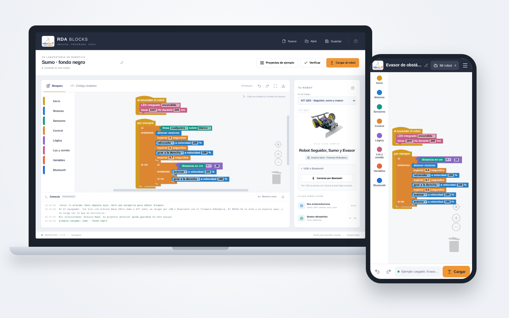
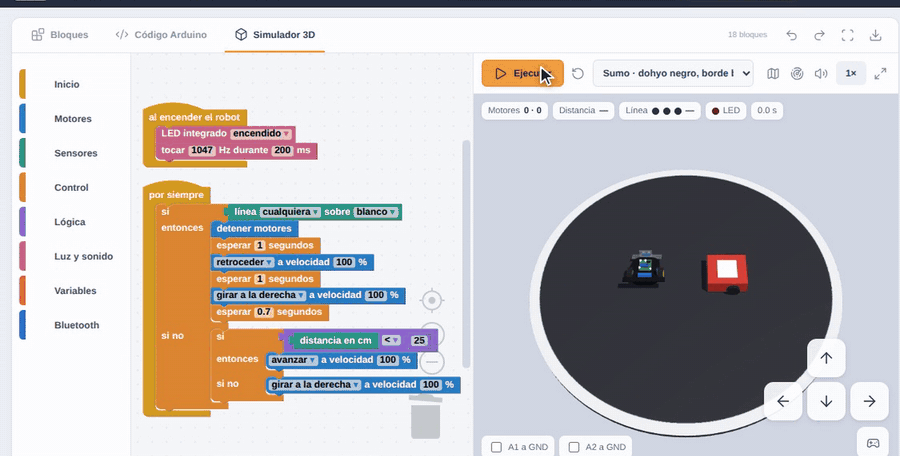
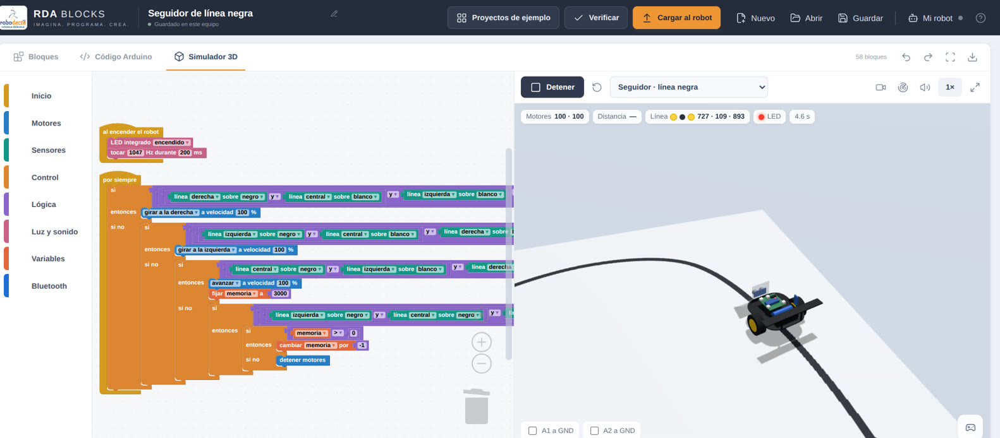
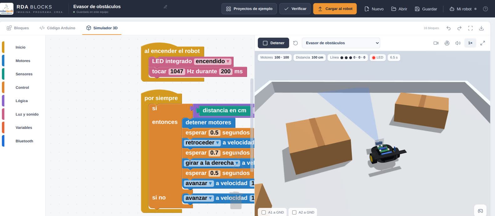
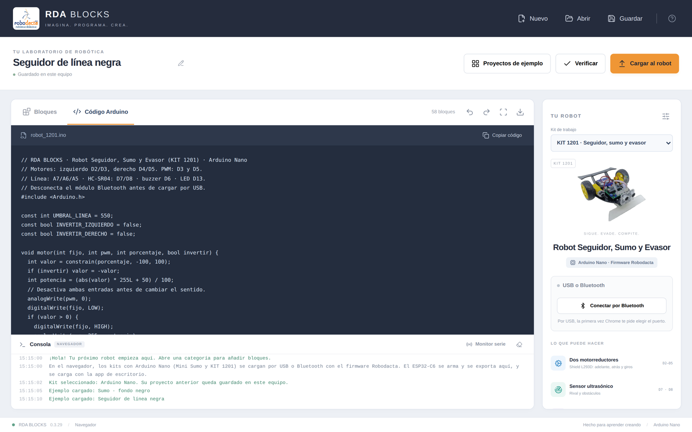
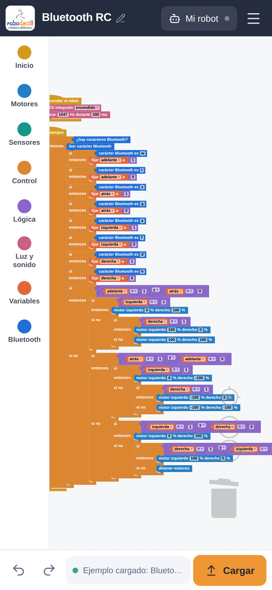
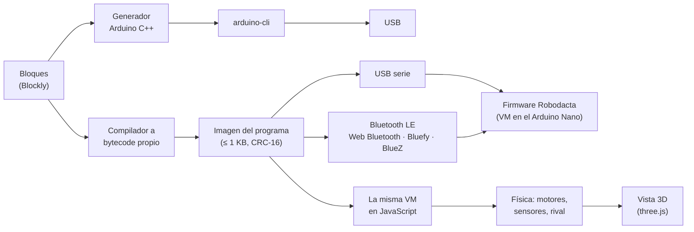

# RDA BLOCKS

**Programación por bloques, en español, para robots educativos con Arduino.** Hecha para los kits de [Robodacta](https://robodacta.com.mx) (KIT 1201 seguidor, sumo y evasor; Mini Sumo 10×10; ESP32-C6).

> Esta es una **vitrina** del proyecto: capturas, arquitectura y algunos fragmentos de código.
> RDA BLOCKS es un producto de Robodacta y su código fuente completo no es público.

---

## ¿Qué es?

Niños, niñas y docentes sin experiencia en programación arman su programa con bloques y lo prueban en un **simulador 3D**. Luego lo cargan a su robot por **USB o Bluetooth**, desde la computadora o desde el celular.

- Editor de bloques en español: motores, sensores de línea, ultrasónico, luz, sonido, variables y Bluetooth.
- **Simulador 3D** que corre el mismo programa que el robot real, sin necesidad de tener el kit.
- Carga en ~2 segundos con un firmware propio, por cable o por Bluetooth.
- Vista del **código Arduino C++** que generan los bloques, para dar el paso a programar con texto.
- Funciona como **app de escritorio** (Linux y Windows), **en el navegador** (plugin de WordPress) y en **celular** (Android y iPhone).

---

## Capturas

| Seguidor de línea en el simulador | Evasor de obstáculos |
|---|---|
|  |  |

| Código Arduino generado | Celular con Bluetooth |
|---|---|
|  |  |

---

## Cómo funciona

**La idea central:** en vez de compilar C++ cada vez que se carga un programa, el robot tiene instalado una sola vez un **intérprete propio (máquina virtual)**. La app traduce los bloques a un bytecode compacto y lo envía en unos 2 segundos. No hace falta compilador y se puede cargar por Bluetooth.

El **simulador** no imita los bloques: ejecuta **la misma imagen** que recibiría el robot, en una copia en JavaScript del firmware. Una prueba automática compila el firmware C++ para la PC y comprueba que las dos máquinas producen **exactamente los mismos eventos** con todos los ejemplos.

---

## Retos técnicos que resolví

- **Una máquina virtual que cabe en un Arduino Nano.** Pila de números de 32 bits, saltos, variables, llamadas y funciones nativas para motores y sensores. Los programas ocupan menos de 1 KB.
- **Dos implementaciones idénticas de la VM** (C++ en el robot, JavaScript en el simulador), verificadas con pruebas que comparan sus resultados paso a paso.
- **Grabar el firmware desde el navegador:** implementé el protocolo STK500 del bootloader del Arduino en JavaScript sobre Web Serial. Prueba los dos bootloaders del Nano y verifica cada página escrita.
- **Bluetooth en todas partes.** Web Bluetooth en Chrome y Edge, la app Bluefy en iPhone (Safari no tiene Web Bluetooth) y una conexión BLE directa en Linux, porque BlueZ abre el módulo BT04-A por su lado clásico y el navegador no puede usarlo.
- **Simulador 3D con física sencilla:** motores con arranque gradual, sensores de línea que leen el piso, ultrasónico con cono de ±15° y un rival que se puede empujar fuera del dohyo. three.js se carga solo al abrir el simulador.
- **Compatibilidad con iPhone 7 (iOS 15):** el código se compila para Safari 15 y lo probé con WebKit automatizado.
- **Pruebas automáticas:** generador de código, máquina virtual (contra el firmware real compilado para la PC) y simulador. Por ejemplo, el seguidor de línea debe dar más de 2 vueltas sin salirse y el sumo debe sacar al rival.
- **Una base de código, tres distribuciones:** Electron para escritorio, plugin de WordPress para la web e interfaz propia para celular, vertical y horizontal.

---

## Tecnologías

| Área | Herramientas |
|---|---|
| Editor | JavaScript, [Blockly](https://github.com/RaspberryPiFoundation/blockly), Vite |
| Simulador | three.js, física propia en JavaScript |
| Escritorio | Electron, arduino-cli, Python (BLE en Linux) |
| Firmware | C++ para Arduino Nano (ATmega328P), Arduino-ESP32 (ESP32-C6) |
| Conexión | Web Serial, Web Bluetooth, STK500, BLE (HM-10 / BT04-A, Nordic UART) |
| Web | Plugin de WordPress (PHP) |
| Pruebas | Node.js, Playwright (Chrome y WebKit) |

Unas **8,000 líneas** de código propio, de la versión 0.1 a la 0.3.32.

---

## Fragmentos de código

Tres extractos para mostrar cómo está organizado el proyecto:

- [`fragmentos/compilador-bloques.js`](fragmentos/compilador-bloques.js): convierte bloques como «avanzar», «esperar» o «si / si no» en bytecode.
- [`fragmentos/ensamblador.js`](fragmentos/ensamblador.js): el ensamblador con etiquetas que resuelve los saltos.
- [`fragmentos/firmware-vm.cpp`](fragmentos/firmware-vm.cpp): el corazón del intérprete que corre en el Arduino Nano.

---

## Cómo se hizo

Desarrollé RDA BLOCKS con **Claude Code (IA)** como asistente de programación.

**Mi parte:** definí qué debía hacer el producto y para quién, diseñé la experiencia pensando en niños y docentes, tomé las decisiones de arquitectura, probé todo con los robots reales (Arduino Nano, BT04-A, ESP32-C6), encontré los fallos y llevé el proyecto hasta un producto que se distribuye con el kit.

**La parte de la IA:** escribir y depurar gran parte del código siguiendo mis indicaciones.

---

## Créditos

- Producto de **[Robodacta](https://robodacta.com.mx)**. Nombre, logo, fotos y kits pertenecen a Robodacta.
- Usa Blockly (Apache-2.0), three.js (MIT), Lucide (ISC), Electron (MIT) y Arduino CLI (AGPL-3.0, como programa independiente).
- No es un producto de Makeblock ni usa código de mBlock.

© Robodacta. Todos los derechos reservados. Las imágenes y fragmentos se muestran solo como portafolio.
